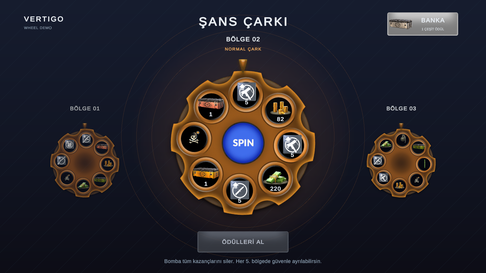

# Vertigo Wheel Demo

A Unity wheel-of-fortune game developed for the Vertigo Games internship case.

**Unity version:** 6000.3.23f1 LTS

**Target platform:** Android, ARM64, landscape

**Status:** Playable demo with the redesigned wheel interface, randomized reward pools, a session bank, and reward reveals. The latest presentation is validated in the Unity Editor; the Android test APK predates this redesign.



## Implemented

- [x] Eight-slot wheel with DOTween spin animation, a fixed center spin button, and input locking during spins and modal windows.
- [x] Previous and next wheel previews; the next preview becomes the exact next playable layout.
- [x] Gentle in-place idle rotation for the current and adjacent wheels, with upright rewards and fixed controls. Idle motion pauses during spins, reveals, transitions, and bank inspection.
- [x] Smooth 0.74-second carousel transitions with slide/scale/fade animation, fixed button layout, and input locking until completion.
- [x] Dark gradient background with resolution-independent decorative geometry.
- [x] All 35 supplied non-bomb reward icons configured as obtainable rewards, plus the bomb.
- [x] Randomized, distinct slot rewards selected once per zone, with stronger silver and premium golden pools.
- [x] Scrollable session bank with reward icons, names, and quantities.
- [x] One-tap reward reveals with the supplied star flash/glow artwork and DOTween animations.
- [x] Editor-configurable rewards, slot amounts, wheel sprites, and indicators using ScriptableObjects.
- [x] Zone progression with bronze wheels in normal zones.
- [x] Bomb-free silver wheels at every fifth zone.
- [x] Bomb-free golden wheels with special item rewards at every thirtieth zone, taking priority over silver wheels.
- [x] Gold, cash, and item accumulation during a session.
- [x] Increasing gold and cash rewards as the player progresses.
- [x] Bomb results that clear the session rewards and end the run.
- [x] Cash-out flow at eligible zones, a separate success message, and session restart.
- [x] Per-slot reward amounts, shared calculation for preview and payout, and hidden amount labels for bombs.
- [x] Upright reward icons and amount labels while the wheel rotates in the latest source.
- [x] TextMeshPro UI, sliced button sprites, and a Sprite Atlas.
- [x] Reusable `game_wheel` prefab containing the UI and session controller.
- [x] Canvas scaling with a 1920 x 1080 reference resolution and Expand mode.
- [x] Android build configuration and an initial APK smoke test in an ARM64 emulator.

## Gameplay

- **SPIN (center button):** Spin the current wheel. A result overlay displays the actual reward icon and quantity; tap anywhere to dismiss it and prepare the next zone. The wheel contents stay fixed while making a decision.
- Normal zones contain one bomb. Landing on it loses all rewards accumulated in the current session.
- Every fifth zone uses a safe silver wheel; every thirtieth zone uses a golden wheel with special rewards. Neither contains a bomb.
- **BANKA / Bank:** Inspect every reward accumulated in the current session. The bank scrolls when the list is long. Opening it pauses gameplay input.
- **ÖDÜLLERİ AL / Collect rewards:** End the session successfully while keeping its bank available for inspection. This is available on entering a safe or super zone, before spinning it, while the wheel is idle and no modal is open.
- **YENİDEN BAŞLAT / Restart:** After a bomb or a successful cash-out, start a new session at zone 1 with empty reward totals.

Rewards are held in memory for the current session; they are not saved between application launches.

### Reward progression

Gold and cash use the following calculation:

```text
earned amount = base amount + floor(base amount * (zone - 1) / 10)
```

Each new zone adds 10% of the base amount, rather than compounding the previous reward. For a base reward of 50, zones 1, 2, 5, and 10 award 50, 55, 70, and 95 respectively. Item quantities remain unchanged. Base values in the wheel assets are not modified at runtime.

This growth formula is a game-design choice; the case brief requires improving rewards but does not specify a numerical formula.

## Run in the Editor

1. Clone this repository and open its root folder through Unity Hub with **Unity 6000.3.23f1**.
2. Allow Unity to import the assets and packages.
3. Open `Assets/Scenes/WheelDemo.unity`.
4. Enter Play mode.

Reward definitions are in `Assets/GameData/Rewards`, and wheel configurations are in `Assets/GameData/Wheels`.

Each wheel has an optional **Reward Pool**. When populated, the selector draws distinct rewards without replacement, always includes both configured currencies, and preserves exactly one bomb for a normal wheel. Silver and golden templates contain no bomb. An empty pool uses the eight manually configured **Slots** unchanged. This keeps both random and fixed layouts editable in the Editor.

| Base reward | Bronze | Silver | Golden |
| --- | ---: | ---: | ---: |
| Gold | 75 | 300 | 1,000 |
| Cash | 200 | 800 | 2,500 |
| Upgrade points | 5 | 20 | Not in golden pool |
| Item quantity | 1 | 2 | 4 |

The golden pool contains premium items only: elite weapons, gold/super chests, the special helmet, and event bayonets. Currency amounts also use the zone growth formula above. These balance values are design choices, not numerical requirements from the brief.

## Build for Android

1. Install **Android Build Support**, **Android SDK & NDK Tools**, and **OpenJDK** for this Editor version through Unity Hub.
2. Open **File > Build Profiles** and switch to Android.
3. Use `Assets/Scenes/WheelDemo.unity` as the enabled scene at build index 0.
4. Use **IL2CPP** with **ARM64**. The application ID is `com.berkaykosen.vertigowheeldemo`.
5. Keep **Auto Rotation** enabled with only Landscape Left and Landscape Right allowed.
6. Disable **Export Project** and **Build App Bundle (Google Play)** to produce an APK. Disable **Development Build** for the final submission build.
7. Select **Build** and save the APK under `Builds/Android`.

Generated build files are ignored by Git. The final APK will be attached to a GitHub Release.

## Validation and remaining work

The new interface has been exercised in **Unity 6000.3.23f1 Play mode** using the scene prefab and actual UI components. Validation covers reward variety/reachability, tier improvements, preview continuity, modal input locking, bank scrolling, correct payout, cash-out, bomb loss, and restart. See [the validation report](Documentation/Presentation/Validation.md).

The Editor tool **Tools > Vertigo > Validate Presentation** reruns those checks and captures UI states. It temporarily sets specific zones/outcomes for testing; these test controls are Editor-only and are not included in the APK. Captures at **20:9, 16:9, and 4:3** are in [Documentation/Presentation](Documentation/Presentation). A walkthrough of the architecture and new functions is available in [Turkish](Documentation/Implementation-TR.md).

**The existing test APK predates this redesign.** An earlier APK was manually smoke-tested in an Android 16 / API 36 ARM64 emulator; that does not validate the new interface on Android.

- [x] Correct cash-out timing: enter a safe/super zone, then collect before spinning.
- [x] Implement the supplied reward artwork, center spin button, adjacent wheel previews, bank, and one-tap result presentation.
- [x] Validate the new gameplay/UI flows in Play mode and inspect captures at all required ratios.
- [ ] Rebuild the APK with the final source and repeat Android testing, including a physical device if available.
- [ ] Record a gameplay video covering the main flows.
- [ ] Publish the final APK as a **GitHub Release** and add release/video links here.

## Project layout

```text
Assets/
  Art/UI/             Provided UI sprites
  Art/Atlases/        UI Sprite Atlas
  GameData/Rewards/   Reward ScriptableObjects
  GameData/Wheels/    Bronze, silver, and golden wheel configurations
  Prefabs/            Reusable game prefab
  Scenes/             WheelDemo scene
  Scripts/Data/       Reward and wheel definitions
  Scripts/Gameplay/   Session rules, reward selection, and controller
  Scripts/UI/         Wheel, previews, buttons, bank, and result presentation
  Editor/             Prefab construction and Play-mode presentation checks
Documentation/        Validation report, captures, and implementation walkthrough
```
